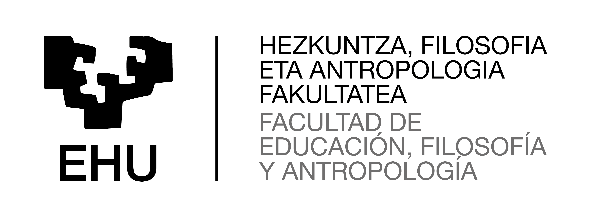

# EMAITZAK {#sec-emaitzak}

::: {.callout-note}
## Edukia: Emaitzak

Atal honetan ikerketan lortutako emaitzak aurkezten dira modu objektiboan eta antolatuan. Helburua da bildutako datuen analisitik ateratako aurkikuntzak azaltzea, interpretazio edo balorazio sakonik egin gabe. Emaitzek ikerketa-galderak eta helburuak gidari izan behar dituzte, eta aurkezpena koherentea izan behar da aurreko atalean deskribatutako analisi-prozedurekin.

**Luzera orientagarria:** %15-25 (%15).

**Aditz-denborak (APA 7):** Iragana.

**Adibidea:** Parte-hartzaileen %78k adierazi zuten prestakuntza espezifikoa jaso zutela hezkuntza inklusiboaren arloan. Elkarrizketetan, berriz, laguntza profesionalaren garrantzia behin eta berriz agertu zen.

**Aipu bibliografikoak:** EZ, salbu eta taula, eskala edo irudi baten iturria adierazi behar denean.
:::

::: {.callout-note}
## Atalaren helburua

Emaitzen atalak ikerketan aurkitutakoa erakusten du. Ez da literatura berririk aurkezten, ezta emaitzen esanahiari buruzko eztabaidarik egiten ere; hori hurrengo atalean, Eztabaidan, garatuko da.
:::

::: {.callout-note}
## Antolaketa

Emaitzak aurkezteko modurik gomendagarriena ikerketa-galderen edo helburu espezifikoen arabera antolatzea da.

**Adibidea:**

- **4.1. Ikerketa-galdera 1 edo Helburu Espezifikoa 1:** Lehen galderari edo helburuari lotutako emaitzak aurkezten dira.
- **4.2. Ikerketa-galdera 2 edo Helburu Espezifikoa 2:** Bigarren galderari edo helburuari lotutako emaitzak aurkezten dira.
- **4.3. Ikerketa-galdera 3 edo Helburu Espezifikoa 3:** Hirugarren galderari edo helburuari lotutako emaitzak aurkezten dira.

Horrela, irakurleak erraz ikus dezake nola erantzuten zaien ikerketaren planteamenduan formulatutako galderei.
:::

::: {.callout-note}
## Ikerketa kuantitatiboetan

Emaitzak datu estatistikoen bidez aurkezten dira.

**Erabil daitezke:**

- Taulak.
- Grafikoak.
- Irudiak.
- Estatistika deskribatzaileak.
- Estatistika inferentzialak.

**Adibidea:** Ikasleen %65ek egunean bi ordu baino gehiago erabiltzen zituzten sare sozialak. Gainera, sare sozialen erabileraren eta autoestimuaren artean korrelazio negatibo esanguratsua aurkitu zen (*r* = -.42; *p* < .05).
:::

::: {.callout-note}
## APA 7: taulak eta grafikoak

Testuan ez dira taulako edo grafikoko datu guztiak errepikatu behar. Testuak aurkikuntza garrantzitsuenak nabarmendu behar ditu.

**Adibidea:** Taula 3an ikus daitekeen bezala, parte-hartzaile gehienek prestakuntza-maila ertaina edo altua zuten.
:::

::: {.callout-note}
## Ikerketa kualitatiboetan

Emaitzak normalean kategorien, gaien edo dimentsioen arabera aurkezten dira. Analisiaren ondorioz sortutako kategoria bakoitza azpiatal batean garatzea gomendatzen da.

**Adibideak:**

**4.1. Laguntza profesionalaren garrantzia**

Parte-hartzaile gehienek azpimarratu zuten lehen urteetan jasotako laguntzak eragin positiboa izan zuela haien integrazio profesionalean.

> "Hasieran lankideen laguntza ezinbestekoa izan zen niretzat."

**4.2. Prestakuntza-beharrak**

Informanteek adierazi zuten prestakuntza teorikoa nahikoa izan arren, praktikara bideratutako prestakuntza gehiago behar zutela.

> "Unibertsitatean teoria asko ikasi genuen, baina egoera errealetarako prestaketa mugatua izan zen."
:::

::: {.callout-note}
## Aipu literalak

Ikerketa kualitatiboetan oso gomendagarria da parte-hartzaileen hitzak jasotzea aurkikuntzak ilustratzeko.

**Aipuek honako ezaugarriak izan behar dituzte:**

- Laburrak eta esanguratsuak izan behar dira.
- Anonimotasuna bermatu behar dute.
- Kode baten bidez identifika daitezke (P1, P2, I3...).

**Adibidea:** "Zuzendaritzaren babesa funtsezkoa izan da proiektu hau aurrera eramateko" (P4).
:::

::: {.callout-note}
## Diseinu mistoetan

Lehenik emaitza kuantitatiboak eta ondoren kualitatiboak aurkez daitezke, edo alderantziz. Bestela, emaitzak ikerketa-galderen arabera integra daitezke.

**Adibidea:** Galdetegiek erakutsi zuten prestakuntza-mailaren eta autoeraginkortasunaren artean erlazioa zegoela. Elkarrizketek, berriz, erlazio horren atzean zeuden esperientziak eta azalpenak identifikatzeko aukera eman zuten.
:::

::: {.callout-note}
## Taulak, irudiak eta grafikoak

Emaitzak argitzeko taulak, irudiak eta grafikoak erabil daitezke.

**APA 7 arauen arabera:**

- Taula eta irudi guztiak zenbakituta egon behar dira.
- Izenburu argia izan behar dute.
- Testuan erreferentziatu behar dira.
- Informazio osagarria oin-oharren bidez eman daiteke.
:::

::: {.callout-note}
## Ohar metodologikoa

Emaitzen atalean ikertzailearen interpretazioa mugatua izan behar da. Atal honen helburua ez da emaitzek zer esan nahi duten azaltzea, baizik eta zer aurkitu den modu argi, sistematiko eta objektiboan erakustea.

Emaitzen interpretazio sakona eta literaturarekin alderaketa hurrengo atalean, Eztabaida atalean, egingo dira.
:::

::: {.callout-note}
## Aipu bibliografikoak

**Aipu bibliografikoak:** EZ, salbu eta taula, eskala edo irudi baten iturria adierazi behar denean.
:::

{#fig-eredua width=70%}

